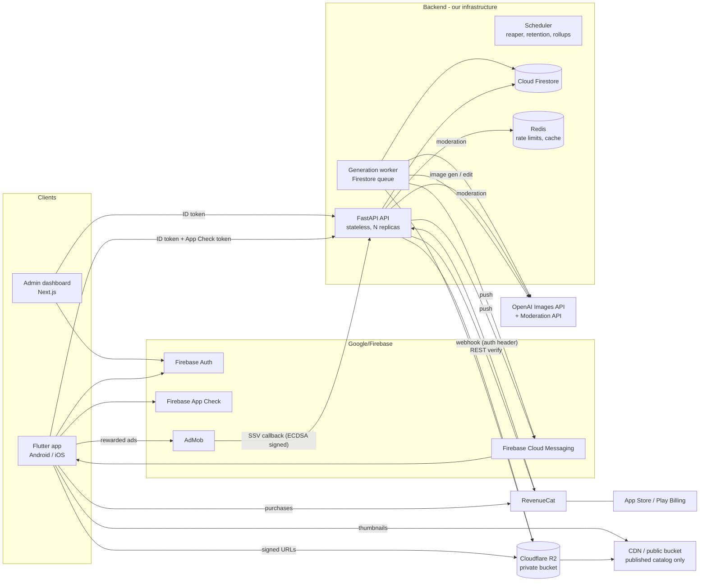

# 2. System Architecture and Repository Structure

## 2.1 High-level architecture



### Key decisions

| Decision | Choice | Rationale |
|----------|--------|-----------|
| Mobile state management | **Riverpod** (latest stable, version pinned in Phase 0) | Testable, compile-safe DI, no `BuildContext` coupling |
| Mobile routing | **go_router** | Deep links, typed routes, redirect guards for auth |
| Mobile networking | **dio** with interceptors (auth token, App Check, request ID, retry with backoff for idempotent GETs) | |
| Models | `freezed` + `json_serializable` | Immutable models; codegen kept in CI |
| Backend framework | **FastAPI + Pydantic v2 + SQLAlchemy 2.x (async, asyncpg) + Alembic** | As specified |
| Database | **Cloud Firestore** via the Admin/Cloud client ([ADR 0002](adr/0002-firestore-instead-of-postgresql.md); the PostgreSQL version is tagged `postgres-reference`) | Owner decision (2026-10-18): stay on Firebase. Only the backend accesses it; security rules deny all client access. |
| Job queue | **Firestore-backed queue** (`generation_jobs` + transactional claim with lease) | Job state, credit reservation and queue live in **one transactional store**, so reserving credits and enqueuing are atomic. Fine at tens of jobs per minute. Revisit with Cloud Tasks or Pub/Sub if throughput demands it. |
| Rate limiting | **Redis** (sliding window, Lua script) | Fast, shared across API replicas. Without Redis (local dev/tests) it falls back to an in-memory limiter. |
| Search | **Open decision (catalog phase):** Firestore has no full-text search. Options: tag/category filters only, or a search service (Typesense, Meilisearch or Algolia; cost and hosting to approve) | Must be decided before the catalog phase. Search sits behind a `SearchRepository` interface either way. |
| Image processing | Pillow (+ `pillow-avif-plugin` optional) and `blurhash-python` | Re-encode, strip EXIF, thumbnails, dominant colour |
| Storage | S3 API via `boto3`/`aioboto3`. Cloudflare R2 in prod, **MinIO** locally | One code path for both |
| Admin UI | Next.js (App Router) + TypeScript + Tailwind + shadcn/ui + TanStack Query/Table | Accessible primitives (Radix), fast to build dense tables |
| Admin auth | Firebase Auth (web) → backend checks the `admin_roles` table | Firebase custom claims are **not** trusted as the source of truth |
| Observability | `structlog` JSON logs with request IDs, Prometheus `/metrics` (internal only), optional Sentry (client + server) | |
| Python version | Target **3.13 in Docker**, with 3.14 tested locally | Some C-extension wheels may lag on 3.14. Verified in Phase 0. |
| Python dependency mgmt | **uv** (lockfile) | Reproducible, fast. Falls back to pip-tools if the user prefers. |
| Reverse proxy | **Nginx** in front of the API (Uvicorn workers) and the admin (Next.js standalone) | TLS termination (or behind a cloud LB/Cloudflare), request body size limits (uploads), timeouts, gzip, basic edge rate limiting, security headers, `/metrics` blocked from public access. Cloud hosting is chosen later as needed. |

### AI provider abstraction (backend)

```python
class ImageProvider(Protocol):
    name: str
    def capabilities(self) -> ProviderCapabilities: ...   # sizes, qualities, edit/mask/reference support, max refs
    async def estimate_cost(self, req: ImageRequest) -> CostEstimate: ...
    async def generate(self, req: ImageRequest) -> ImageResult: ...       # text -> image
    async def edit(self, req: ImageEditRequest) -> ImageResult: ...        # refs (+ optional mask)
```

- `OpenAIImageProvider`: official `openai` Python SDK. The model name per tier comes from config (see §8). Uses response `usage` tokens to compute **actual** cost.
- `FakeImageProvider`: deterministic local images (gradients/noise seeded from the prompt hash) for dev, UI work and tests. It is **only** enabled when `IMAGE_PROVIDER=fake`, and the app shows a visible "FAKE PROVIDER" badge in non-prod builds.
- The UI never offers a capability unless the provider reports it in `capabilities()`.

## 2.2 Repository structure (monorepo)

```
wallora-ai/
├── README.md                     # Overview, quick start
├── AGENTS.md                     # Conventions for AI/human contributors
├── .editorconfig  .gitignore  .gitattributes
├── .github/workflows/            # backend.yml, mobile.yml, admin.yml, security.yml
├── docs/                         # These docs + ADRs (docs/adr/NNNN-*.md)
├── backend/
│   ├── pyproject.toml  uv.lock  .env.example
│   ├── alembic.ini  alembic/versions/
│   ├── app/
│   │   ├── main.py               # app factory, middleware, routers
│   │   ├── core/                 # config, logging, errors (RFC 9457), security, rate_limit, idempotency, pagination
│   │   ├── db/                   # engine/session, base model, mixins (UUIDv7 ids, UTC timestamps)
│   │   ├── integrations/         # firebase_auth, app_check, storage(s3), push(fcm), revenuecat, admob_ssv
│   │   ├── providers/
│   │   │   ├── image/            # base.py, openai.py, fake.py, registry.py
│   │   │   └── moderation/       # base.py, openai.py, blocklist.py, fake.py
│   │   ├── modules/              # one package per bounded context:
│   │   │   ├── users/ catalog/ library/ studio/ credits/ billing/
│   │   │   ├── moderation/ notifications/ app_config/ admin/ audit/
│   │   │   └── <module>/{models,schemas,repository,service,router}.py
│   │   └── worker/               # runner.py (job loop), tasks/, scheduler.py (reaper, retention, rollups)
│   └── tests/{unit,integration,api,contract}/
├── mobile/
│   ├── pubspec.yaml  analysis_options.yaml  l10n.yaml
│   ├── lib/
│   │   ├── main_dev.dart main_prod.dart
│   │   ├── app/                  # bootstrap, router, env, app widget
│   │   ├── core/
│   │   │   ├── design_system/    # tokens (color, spacing, radius, type, motion), themes, components
│   │   │   ├── network/          # api client, interceptors, problem-details errors
│   │   │   ├── l10n/ storage/ platform/ (wallpaper channel) utils/
│   │   └── features/
│   │       └── onboarding/ auth/ discover/ search/ wallpaper/ preview/ studio/
│   │           library/ credits/ premium/ notifications/ settings/ account/
│   │           └── <feature>/{data,domain,presentation}/
│   ├── android/ ios/
│   ├── test/ (unit, widget, golden)  integration_test/
├── admin/
│   ├── package.json  next.config.ts  .env.example
│   ├── src/app/(auth)/login  src/app/(dashboard)/{wallpapers,categories,tags,collections,
│   │        reports,users,jobs,credits,config,metrics,audit,admins}/
│   ├── src/lib/{api,auth}  src/components/
│   └── tests/ (vitest unit, playwright e2e)
└── infrastructure/
    ├── compose.yaml              # redis, minio (optional; local dev runs the Firestore emulator)
    ├── firebase/                 # firestore.rules, firestore.indexes.json
    ├── docker/                   # backend.Dockerfile, admin.Dockerfile
    ├── nginx/                    # nginx.conf, site configs (api, admin), security headers
    ├── deploy/                   # target-specific manifests (chosen in Phase 9)
    └── scripts/                  # backup/restore, seed, smoke tests
```

## 2.3 Environments
| Env | Purpose | AI provider | Payments/Ads |
|-----|---------|-------------|--------------|
| `local` | Developer machine | `fake` (default) | RevenueCat sandbox, AdMob **test** units |
| `test` | CI | `fake` (always) | Mocked HTTP |
| `staging` | Pre-release | `openai` with **low** spend cap | Sandbox / test |
| `prod` | Live | `openai` | Live |

Config comes from environment variables validated by `pydantic-settings`. The app **refuses to start** if prod has `IMAGE_PROVIDER=fake`, debug enabled, or missing secrets.

## 2.4 Mobile design system (summary)
- Tokens: colour (neutral scale + one accent + semantic colours, tuned for both themes), spacing (4-pt scale: 4/8/12/16/24/32/48), radii (8/16/24/full), elevation, type scale (variable sans font with an OFL licence, e.g. *Inter* or *Manrope*, chosen in Phase 3), motion (150/250/400 ms, standard easing, all off under reduced motion).
- Imagery-first: edge-to-edge grids, blurhash placeholders, shimmer skeletons, a restrained gradient only on premium/CTA surfaces.
- Components: `WalloraButton`, `WallpaperTile`, `SectionHeader`, `CreditChip`, `EmptyState`, `ErrorState`, `OfflineBanner`, `PermissionDeniedState`, `BottomSheetScaffold`, `SkeletonGrid`.
