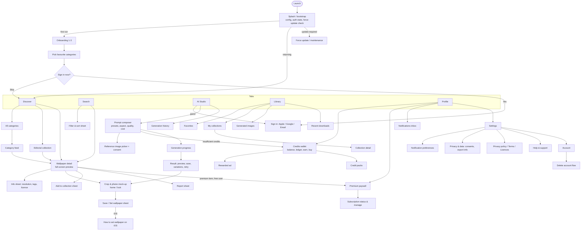

# 3. Screen Inventory and Navigation Flow

## 3.1 Navigation structure
Bottom navigation (5 tabs, each with its own preserved navigation stack via `StatefulShellRoute`):

**Discover · Search · Studio · Library · Profile**

## 3.2 Screen inventory

| # | Screen | Purpose | Key states (beyond loading/error/retry/offline) | Auth |
|---|--------|---------|-----------------------------------|------|
| 1 | Splash/bootstrap | Load remote config, restore session, version gate | Maintenance, force update | — |
| 2 | Onboarding (3 pages) | Value proposition with real artwork | Skippable | — |
| 3 | Category preferences | Personalise Discover | Zero selected allowed | — |
| 4 | Sign in | Apple / Google / email + password reset | Account disabled, network, cancelled sign-in | — |
| 5 | Discover | Featured carousel, trending, latest, collections, categories | Empty catalog (admin hasn't published) | Guest OK |
| 6 | Categories list | Grid of categories with covers | Empty | Guest OK |
| 7 | Category feed | Infinite grid, sort | Empty category, end of list | Guest OK |
| 8 | Editorial collection | Curated set | Empty | Guest OK |
| 9 | Search | Query, recent searches, suggestions, results grid | No results (with suggestions), typo-tolerant | Guest OK |
| 10 | Filter & sort sheet | Category, tags, aspect, colour, premium, sort | Reset | Guest OK |
| 11 | Wallpaper detail | Full-screen pager, actions bar | Premium-locked, removed/unavailable (410) | Guest OK (favorite requires sign-in) |
| 12 | Info sheet | Resolution, aspect, size, tags, attribution/licence | — | Guest OK |
| 13 | Crop & mock-up preview | Pan/zoom crop to device aspect; home and lock overlays | Low-resolution warning | Guest OK |
| 14 | Save / Set sheet | Save to gallery; Android: set home/lock/both | Photos permission denied (link to settings), set failure | Guest OK |
| 15 | iOS wallpaper guide | Step-by-step instructions | — | — |
| 16 | Add to collection sheet | Pick or create collection | Collection limit reached | Signed in |
| 17 | Report sheet | Reason and details | Already reported | Signed in |
| 18 | AI Studio composer | Prompt, enhancer, presets, aspect, quality, cost preview, balance | Insufficient credits, prompt rejected by moderation, quota/rate limited, provider down, tier-locked quality | Signed in |
| 19 | Reference image picker | Pick 1–N images, validate, consent to processing | Too large/unsupported, rejected by moderation, permission denied | Signed in |
| 20 | Generation progress | Status timeline (queued → processing), cancel while queued, background-safe | Cancelled, failed (credits refunded), timed out | Signed in |
| 21 | Generation result | Preview, save, set, add to collection, variation, retry, report | Output blocked by safety (refunded) | Signed in |
| 22 | Generation history | Paginated jobs with thumbnails and status | Empty | Signed in |
| 23 | Library: Favorites | Grid | Empty with CTA | Signed in |
| 24 | Library: My collections | List and create/rename/delete | Empty | Signed in |
| 25 | Collection detail (user) | Grid, reorder, remove | Empty | Signed in |
| 26 | Library: Generated | User's generated images | Empty → Studio CTA | Signed in |
| 27 | Library: Downloads | Recent downloads (server + local) | Empty | Signed in |
| 28 | Credits wallet | Balance by bucket and expiry, ledger, earn (ad), buy packs | Ad unavailable / daily ad cap reached, purchase pending | Signed in |
| 29 | Premium paywall | Plans from RevenueCat offerings, benefits, legal text, restore | Offerings unavailable, purchase cancelled/pending/failed, already subscribed | Signed in |
| 30 | Subscription status | Plan, renewal date, billing issue, manage link (store) | Billing grace/issue, expired | Signed in |
| 31 | Notifications inbox | In-app list of notifications | Empty | Signed in |
| 32 | Settings | Theme, language, notifications, privacy, legal, support, about | — | Guest OK (subset) |
| 33 | Notification preferences | Per-type toggles; reflects OS permission | OS permission denied | Signed in |
| 34 | Privacy & data | Consents (ads personalisation, analytics), data retention explanation | — | Guest OK |
| 35 | Profile / account | Display name, avatar, linked providers, sign out | — | Signed in |
| 36 | Delete account | Explain consequences, active-subscription warning, re-auth, confirm | Re-auth required, failure | Signed in |
| 37 | Force update / maintenance | Blocking screen driven by `/v1/config` | — | — |
| 38 | Edit (mask) — *post-MVP* | Brush mask, prompt, edit | Unsupported by provider → hidden | Signed in |

## 3.3 Cross-cutting UX rules
- **Offline**: cached Discover/Library data stays viewable with an offline banner. Mutating actions are disabled or queued (favorites queue locally and sync later). Studio is disabled offline.
- **Premium gating**: a lock badge appears on premium wallpapers and the paywall opens on download. Premium status always comes from the server (`/v1/me/entitlements`), and the RevenueCat SDK state is only used for UX hints.
- **Credits**: cost is shown *before* generation and the balance updates from the server after each action. No optimistic client-side balance math.
- **Platform guidance**: the Save/Set sheet adapts by platform. Copy never claims that iOS can set wallpapers automatically.
- **Ads**: rewarded only, always user-initiated, never on Premium. No interstitials in the MVP (they hurt a premium visual brand).
