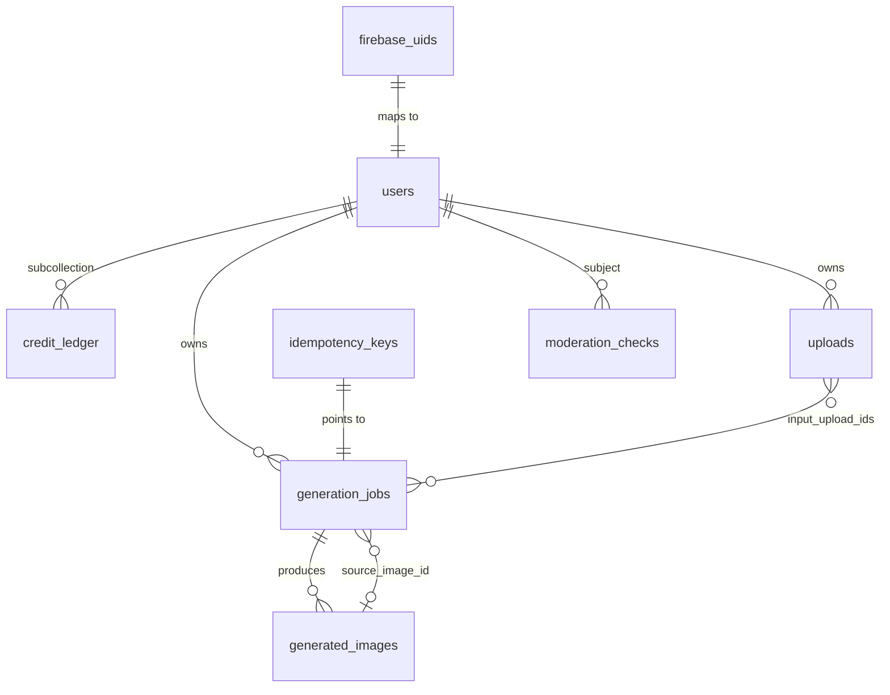

# 4. Database Design (Cloud Firestore)

> **Changed 2026-10-18:** the owner chose Cloud Firestore instead of PostgreSQL (see [ADR 0002](adr/0002-firestore-instead-of-postgresql.md)). The tested PostgreSQL design is preserved in git tag `postgres-reference`.

## 4.1 Conventions
- **Access**: only the FastAPI backend touches Firestore, through the Admin SDK. [Security rules](../infrastructure/firebase/firestore.rules) deny all direct client reads and writes, so a modified app can't forge credits, jobs or entitlements.
- **IDs**: UUIDv7 strings (time-ordered, non-enumerable), except where a deterministic ID gives idempotency (noted below).
- **Timestamps**: UTC `datetime` values (Firestore `Timestamp`).
- **Money**: provider cost as integer micro-USD.
- **Typed documents**: [`app/db/documents.py`](../backend/app/db/documents.py) dataclasses mirror every stored document.
- **Transactions**: server SDKs use pessimistic locks. Every transaction follows "read everything, decide in memory, then write". **No queries run inside credit transactions** (they lock ranges and collapse under contention). See [`app/db/firestore.py`](../backend/app/db/firestore.py).

## 4.2 Collections

| Collection / document | Key fields | Notes |
|-----------------------|-----------|-------|
| `users/{user_id}` | firebase_uid, email, status, **held**, **credit_lots** (map lot_id → lot), **ledger_seq**, recent_job_times, recent_upload_times, strike_times | The per-user lock document. Every credit mutation reads it, which serialises same-user changes. Expired lots are pruned 48 h after expiry. |
| `users/{user_id}/credit_ledger/{seq:012d}` | entry_type, amount, held_delta, available_after, held_after, lot_id, job_id, reason | **Append-only**: written with `create()` (fails if the ID exists). Gap-free sequence. Never updated or deleted by the app. |
| `firebase_uids/{firebase_uid}` | user_id | Created in the same transaction as the user, so concurrent first sign-ins can't create two users. |
| `idempotency_keys/{sha256(user_id, key)}` | job_id, user_id | Created in the job-creation transaction: one job per (user, Idempotency-Key). |
| `generation_jobs/{job_id}` | status, kind, prompt (private), tier, size, model, credit_cost, estimated/actual cost, **reservation** {amount, status, allocations[]}, input_upload_ids, attempts, lease_owner/expires_at, next_attempt_at, error_code, visible | The queue *and* the record. Prompt is erased on delete. |
| `uploads/{upload_id}` | user_id, storage_key, sha256, moderation_status, expires_at, deleted | Reference images; purged after retention unless an active job needs them. |
| `generated_images/{image_id}` | job_id, user_id, storage_key, thumb_key, width, height | Objects live in private storage and are served by signed URLs. |
| `moderation_checks/{id}` | user_id, subject_type, provider, decision, categories | Category names only, never content. |
| `spend_counters/{scope:id:period:start}` | cost_usd_micros, job_count | Global day/month and per-user day counters, read and updated inside the reservation transaction. |

### Lot IDs and idempotent grants
`lot_id = sha256(source, source_ref)`: welcome = `("welcome", "welcome")`, daily = `("daily_free", "2026-10-18")`, refund = `("refund", job_id)`. A grant whose lot ID already exists on the user document is a no-op.

## 4.3 Composite indexes
Defined in [`firestore.indexes.json`](../infrastructure/firebase/firestore.indexes.json) (the emulator doesn't enforce indexes, so **these are untested until deployed**):

| Query | Index |
|-------|-------|
| Worker claim: queued jobs due now | `generation_jobs(status, next_attempt_at)` |
| Reaper: expired leases | `generation_jobs(status, lease_expires_at)` |
| History: a user's visible jobs, newest first | `generation_jobs(user_id, visible, created_at desc, id desc)` |
| Upload purge | `uploads(deleted, expires_at)` |

## 4.4 Known limits and trade-offs
| Limit | Impact | Mitigation / plan |
|-------|--------|-------------------|
| Global spend counters are single documents | Serialises reservations across all users | Fine for early traffic. Move to sharded counters with approximate caps if sustained load demands it (Phase 9 load test). |
| Same-user transactions serialise on `users/{id}` | Bursts from one user queue up | One user rarely sends many parallel requests. The backoff wrapper turns exhaustion into `503 busy`, never a double spend. |
| Firestore emulator is slow under contention (locks can take up to 30 s to release, per Firebase docs) | Tests use 5-way concurrency, not more | Production contention behaviour must be load-tested on staging. |
| No database triggers | The ledger's append-only rule is enforced by code (`create()`) and client-deny rules, not by the database | Admin tooling must never offer ledger edits. Corrections are new entries. |
| Free tier: 50k reads, 20k writes, 20k deletes per day; 1 GiB stored | Roughly 10–20 writes per generation means about 1,000–2,000 generations/day on the free tier (estimate) | Monitor usage. The Blaze plan is needed beyond that. |

## 4.5 Data retention
Unchanged from the plan: reference uploads deleted 7 days after use, generated images kept until deleted by the user, prompts erased on job deletion, ledger kept (pseudonymised on account deletion), logs 30 days without prompts or tokens.
