# 4. Database Design (PostgreSQL 16+)

## 4.1 Conventions
- **IDs**: `uuid` primary keys, generated as **UUIDv7** in the app (time-ordered, index-friendly, non-enumerable). Append-only, high-volume tables (`credit_ledger`, `audit_logs`) also get a `bigint` identity column (`seq`) for strict ordering.
- **Timestamps**: `timestamptz`, always UTC, `created_at`/`updated_at` default `now()`. Soft delete uses `deleted_at` only where retention requires it.
- **Enums**: PostgreSQL `text` + `CHECK` constraints rather than native enums, because they're easier to migrate. Python `StrEnum` mirrors them.
- **Money**: provider cost stored as integer **micro-USD** (`cost_usd_micros`). Store prices are display-only strings from the stores, never computed.
- **Extensions**: `pg_trgm`, `citext`. FTS uses built-in `tsvector`.
- **Migrations**: Alembic only. Each migration is reviewed, reversible where practical, and tested (`upgrade head` → `downgrade -1` → `upgrade head` in CI).
- **Append-only enforcement**: `credit_ledger` and `audit_logs` have a trigger that rejects `UPDATE`/`DELETE`. The app DB role also has no `UPDATE`/`DELETE` privilege on them.

## 4.2 ERD

```mermaid
erDiagram
  users ||--|| user_preferences : has
  users ||--o{ user_preferred_categories : picks
  categories ||--o{ user_preferred_categories : ""
  users ||--o{ device_tokens : registers
  users ||--o{ admin_roles : granted
  users ||--o{ favorites : ""
  users ||--o{ collections : owns
  users ||--o{ downloads : ""
  users ||--o{ uploads : ""
  users ||--o{ generation_jobs : ""
  users ||--o{ generated_images : ""
  users ||--|| credit_accounts : ""
  users ||--o{ credit_lots : ""
  users ||--o{ credit_reservations : ""
  users ||--o{ credit_ledger : ""
  users ||--o{ purchase_entitlements : ""
  users ||--o{ purchase_transactions : ""
  users ||--o{ moderation_reports : files
  users ||--o{ notifications : receives
  users ||--o{ account_deletion_requests : ""

  categories ||--o{ wallpapers : primary
  wallpapers ||--o{ wallpaper_tags : ""
  tags ||--o{ wallpaper_tags : ""
  wallpapers ||--o{ favorites : ""
  collections ||--o{ collection_items : contains
  wallpapers ||--o{ collection_items : ""
  generated_images ||--o{ collection_items : ""
  wallpapers ||--o{ downloads : ""
  generated_images ||--o{ downloads : ""

  style_presets ||--o{ generation_jobs : uses
  generation_jobs ||--o{ generation_job_inputs : ""
  uploads ||--o{ generation_job_inputs : ""
  generation_jobs ||--o{ generated_images : produces
  generation_jobs ||--o| credit_reservations : holds
  credit_reservations ||--o{ credit_reservation_allocations : ""
  credit_lots ||--o{ credit_reservation_allocations : ""
  credit_lots ||--o{ credit_ledger : ""
  credit_reservations ||--o{ credit_ledger : ""

  webhook_events ||--o{ purchase_transactions : sourced
  product_catalog ||--o{ purchase_transactions : ""
  moderation_checks }o--|| generation_jobs : "subject (polymorphic)"
  users ||--o{ audit_logs : "actor"
```

## 4.3 Tables

### Identity & preferences
| Table | Columns (key ones) | Constraints / indexes |
|-------|--------------------|------------------------|
| `users` | id, firebase_uid, email (citext, nullable), email_verified, display_name, avatar_storage_key, auth_providers text[], status (`active`/`suspended`/`pending_deletion`/`deleted`), locale, last_seen_at, created_at, updated_at, deleted_at | UQ(firebase_uid), IX(email), IX(status) |
| `user_preferences` | user_id PK/FK, theme (`system`/`light`/`dark`), notify_generation, notify_new_content, notify_marketing (default **false**), ads_personalization_consent, analytics_consent, updated_at | |
| `user_preferred_categories` | user_id, category_id, created_at | PK(user_id, category_id) |
| `device_tokens` | id, user_id, fcm_token, platform, app_version, locale, last_seen_at, created_at | UQ(fcm_token), IX(user_id) |
| `admin_roles` | user_id, role (`super_admin`/`content_admin`/`moderator`/`support`/`analyst`), granted_by, granted_at | PK(user_id, role) |
| `account_deletion_requests` | id, user_id, status (`scheduled`/`cancelled`/`completed`/`failed`), requested_at, scheduled_for, completed_at, failure_reason | IX(status, scheduled_for) |

### Catalog
| Table | Columns | Constraints / indexes |
|-------|---------|------------------------|
| `categories` | id, slug, name, name_i18n jsonb, description, cover_wallpaper_id (nullable FK, `DEFERRABLE`), sort_order, is_active, created_at, updated_at | UQ(slug), IX(is_active, sort_order) |
| `tags` | id, slug, name, created_at | UQ(slug), GIN trigram on name |
| `wallpapers` | id, title, description, category_id, status (`draft`/`published`/`archived`/`removed`), is_premium, width, height, aspect_ratio numeric(6,4) (generated), dominant_color, blurhash, mime_type, file_size_bytes, storage_key_original, storage_key_preview, storage_key_thumb, sha256, source_type (`original`/`licensed`/`ai_inhouse`), license_type, license_url, attribution, uploaded_by, published_at, trending_score, download_count, favorite_count, view_count, search_vector tsvector (generated from title/description), created_at, updated_at | UQ(sha256); IX(status, published_at DESC); IX(category_id, status, published_at DESC); IX(status, trending_score DESC); GIN(search_vector); CHECK(width>0 AND height>0) |
| `wallpaper_tags` | wallpaper_id, tag_id | PK(wallpaper_id, tag_id), IX(tag_id) |
| `collections` | id, kind (`editorial`/`user`), owner_user_id (nullable), slug (editorial only), title, description, cover_wallpaper_id, is_featured, sort_order, item_count, created_at, updated_at | CHECK((kind='editorial') = (owner_user_id IS NULL)); partial UQ(slug) WHERE kind='editorial'; IX(owner_user_id, updated_at DESC); IX(is_featured, sort_order) |
| `collection_items` | id, collection_id, wallpaper_id (nullable), generated_image_id (nullable), position, added_at | CHECK(exactly one target); partial UQ(collection_id, wallpaper_id), partial UQ(collection_id, generated_image_id); IX(collection_id, position) |
| `favorites` | user_id, wallpaper_id, created_at | PK(user_id, wallpaper_id), IX(user_id, created_at DESC) |
| `downloads` | id, user_id, wallpaper_id (nullable), generated_image_id (nullable), platform, created_at | CHECK(exactly one target); IX(user_id, created_at DESC) |

### Studio / generation
| Table | Columns | Constraints / indexes |
|-------|---------|------------------------|
| `style_presets` | id, slug, name, name_i18n, prompt_suffix, thumbnail_key, is_premium, is_active, sort_order | UQ(slug) |
| `uploads` | id, user_id, purpose (`reference`/`mask`), storage_key, mime_type, size_bytes, width, height, sha256, moderation_status (`pending`/`passed`/`blocked`), expires_at, created_at, deleted_at | IX(user_id, created_at DESC), IX(expires_at) for purge |
| `generation_jobs` | id, user_id, idempotency_key, request_hash, kind (`generate`/`edit`/`variation`), status (`queued`/`processing`/`succeeded`/`failed`/`cancelled`), prompt (private), enhanced_prompt, style_preset_id, tier (`draft`/`standard`/`hd`), width, height, quality, output_format, provider, model, credit_cost, estimated_cost_usd_micros, actual_cost_usd_micros, usage jsonb (token counts only), provider_request_id, attempts, max_attempts, next_attempt_at, lease_owner, lease_expires_at, cancel_requested_at, error_code, error_detail_safe, retry_of_job_id, started_at, finished_at, created_at, updated_at | **UQ(user_id, idempotency_key)**; partial IX(next_attempt_at) WHERE status='queued'; partial IX(lease_expires_at) WHERE status='processing'; IX(user_id, created_at DESC); IX(status, created_at) |
| `generation_job_inputs` | job_id, upload_id, role (`reference`/`mask`), position | PK(job_id, upload_id) |
| `generated_images` | id, job_id, user_id, storage_key, thumb_key, width, height, mime_type, size_bytes, blurhash, moderation_status, is_favorite, created_at, deleted_at | IX(user_id, created_at DESC), IX(job_id) |
| `moderation_checks` | id, subject_type (`prompt`/`upload`/`output`), subject_id, provider, decision (`allow`/`flag`/`block`), categories jsonb (scores only, no content), created_at | IX(subject_type, subject_id), IX(decision, created_at) |

### Credits (see [06](06-generation-and-credits.md) for the lifecycle)
| Table | Columns | Constraints / indexes |
|-------|---------|------------------------|
| `credit_accounts` | user_id PK, available_cached int, held_cached int, version, updated_at | CHECK(available_cached ≥ 0). This row is the **lock target** for all credit mutations. |
| `credit_lots` | id, user_id, source (`welcome`/`daily_free`/`reward_ad`/`purchase`/`subscription`/`admin`/`refund`), source_ref, amount_granted, amount_remaining, expires_at (nullable), created_at | **UQ(user_id, source, source_ref)** (idempotent grants); CHECK(0 ≤ amount_remaining ≤ amount_granted); IX(user_id, expires_at) WHERE amount_remaining > 0 |
| `credit_reservations` | id, user_id, job_id, amount, status (`held`/`captured`/`released`), created_at, resolved_at | UQ(job_id) |
| `credit_reservation_allocations` | reservation_id, lot_id, amount | PK(reservation_id, lot_id) |
| `credit_ledger` | seq bigint identity, id, user_id, entry_type (`grant`/`reserve`/`capture`/`release`/`expire`/`revoke`/`admin_adjust`), amount (signed), lot_id, reservation_id, job_id, balance_after, reason, idempotency_key, actor_user_id, created_at | **Append-only**; UQ(idempotency_key) WHERE NOT NULL; IX(user_id, seq DESC) |
| `spend_counters` | scope (`global`/`user`), scope_id, period (`day`/`month`), period_start date, cost_usd_micros, job_count | PK(scope, scope_id, period, period_start). Atomic `UPDATE … RETURNING` for caps. |

### Billing
| Table | Columns | Constraints / indexes |
|-------|---------|------------------------|
| `product_catalog` | id, kind (`subscription`/`credit_pack`), store (`app_store`/`play_store`), store_product_id, entitlement_id, credits, monthly_credits, is_active, sort_order | UQ(store, store_product_id) |
| `purchase_entitlements` | id, user_id, provider (`revenuecat`), entitlement_id, product_id, store, status (`active`/`grace_period`/`billing_issue`/`expired`/`refunded`/`paused`), will_renew, period_type, purchased_at, expires_at, original_transaction_id, environment (`sandbox`/`production`), last_synced_at, updated_at | UQ(user_id, provider, entitlement_id); IX(expires_at) |
| `purchase_transactions` | id, user_id, provider, store, store_transaction_id, product_id, kind, credits_granted, environment, purchased_at, refunded_at, webhook_event_id | **UQ(store, store_transaction_id)** — guarantees one grant per purchase |
| `webhook_events` | id, provider (`revenuecat`/`admob_ssv`), external_event_id, event_type, payload jsonb (**redacted**), signature_valid, status (`received`/`processed`/`ignored`/`failed`), attempts, last_error, received_at, processed_at | **UQ(provider, external_event_id)** — replay/duplicate protection; IX(status, received_at) |
| `reward_ad_sessions` | id, user_id, nonce, status (`issued`/`rewarded`/`expired`), issued_at, rewarded_at, ssv_transaction_id | UQ(nonce), UQ(ssv_transaction_id) |

### Moderation, notifications, config, audit
| Table | Columns | Constraints / indexes |
|-------|---------|------------------------|
| `moderation_reports` | id, reporter_user_id, target_type (`wallpaper`/`generated_image`), target_id, reason (`copyright`/`sexual`/`violence`/`hate`/`minor_safety`/`spam`/`other`), details, status (`open`/`reviewing`/`actioned`/`dismissed`), resolved_by, resolution_note, created_at, resolved_at | UQ(reporter_user_id, target_type, target_id); IX(status, created_at) |
| `notifications` | id, user_id, type, title_key/title, body, data jsonb, status (`pending`/`sent`/`failed`), read_at, sent_at, created_at | IX(user_id, created_at DESC) |
| `app_settings` | key PK, value jsonb, schema_version, updated_by, updated_at | Validated by Pydantic models per key. Every change is written to `audit_logs`. |
| `audit_logs` | seq, id, actor_user_id, actor_type (`admin`/`system`), action, target_type, target_id, changes jsonb (redacted diff), ip_hash, user_agent, request_id, created_at | **Append-only**; IX(actor_user_id, seq DESC); IX(target_type, target_id) |

## 4.4 Schema decisions vs. the brief
| Change | Why |
|--------|-----|
| Added `credit_accounts`, `credit_lots`, `credit_reservations`, `credit_reservation_allocations` alongside `credit_ledger` | Credits come from buckets with different expiries (daily free vs. purchased). Lots make "spend soonest-expiring first" and exact refunds possible. The ledger stays the immutable audit trail. |
| Added `uploads`, `generated_images`, `generation_job_inputs` | Jobs can have several references and outputs, each with its own moderation and retention |
| Added `purchase_transactions`, `product_catalog`, `reward_ad_sessions` | One-grant-per-transaction idempotency; configurable products; ad reward replay protection |
| Added `spend_counters` | O(1) atomic enforcement of daily/monthly cost caps |
| Added `moderation_checks`, `device_tokens`, `account_deletion_requests`, `app_settings`, `style_presets`, `user_preferred_categories` | Required by moderation, push, deletion, configurable monetization and presets |
| `collections` covers both editorial and user collections | One model and UI. A `kind` + CHECK constraint enforces ownership rules. |
| `name_i18n jsonb` instead of translation tables | Few translatable fields, admin-edited, read-heavy. Simpler without losing integrity. Revisit if translation workflows grow. |

## 4.5 Data retention (summary — full policy in Phase 8 privacy doc)
| Data | Retention |
|------|-----------|
| Reference uploads | Deleted **7 days** after the last job that used them (configurable), or on user request |
| Generated images | Until the user deletes them or deletes their account |
| Prompts | Kept with the job for history. On account deletion they are erased. Admin viewing is restricted to `moderator` and audit-logged. |
| Account deletion | Status set to `pending_deletion` immediately (access revoked), with a hard purge after **14 days** (cancellable grace window): Firebase user deleted, storage objects deleted, PII erased. Ledger/transaction rows are kept with `user_id` pseudonymised for financial/legal record keeping. |
| Webhook payloads | 90 days (redacted), then the payload is nulled |
| Audit logs | 1 year minimum |
| Logs | 30 days, no prompts, tokens or PII |
