# 6. AI Generation and Credit Lifecycle

## 6.1 Provider facts this design relies on
Checked against OpenAI's official docs on 2026-10-18 ([image generation guide](https://developers.openai.com/api/docs/guides/image-generation), [pricing](https://developers.openai.com/api/docs/pricing)). **These must be re-verified in Phase 5 before any paid call.**

- Image models listed: `gpt-image-2.5-flare` ("fast, high-quality everyday generation"), `gpt-image-2.5-sunburst` ("editing precision"), `gpt-image-2`, `gpt-image-1.5`, `gpt-image-1-mini`, `gpt-image-1`.
- Sizes: `1024x1024`, `1536x1024`, `1024x1536` are recommended. Custom `WxH` is allowed when both edges are multiples of 16, the aspect ratio is 1:3–3:1, no edge exceeds 3840, and total pixels are 655,360–8,294,400. **Above 2560×1440 is experimental.**
- Quality: `low`/`medium`/`high`/`xhigh`/`max`/`auto` (xhigh/max only on 2.5 models). Output: png/jpeg/webp (+ compression).
- Edits accept **multiple input images** and an optional **mask** (alpha channel, same size, applies to the first image, prompt-guided and inexact).
- `moderation`: `auto` (default) | `low`. **We use `auto`.**
- Billing is per token (text in, image in, image out). Standard tier image output costs $30/1M tokens on 2.5/2 models and $8/1M on `gpt-image-1-mini`. The pricing page has **no per-image price table** and points to a calculator, so per-image estimates are **derived from returned `usage`**, not assumed.

### Phone-wallpaper resolution strategy
Modern phones are roughly 9:19.5–9:20. Candidate presets (all multiples of 16, within constraints):

| Preset | Size | Pixels | Notes |
|--------|------|--------|-------|
| Portrait (safe) | 1024×1536 | 1.57 MP | Recommended size; client crop/fit |
| Tall phone | 1072×2320 | 2.49 MP | ≈ 9:19.5, under the experimental threshold (3.69 MP) |
| Tall phone HD | 1440×3120 | 4.49 MP | **Experimental**, premium/HD tier only, behind a flag |

Final presets are chosen after a small, **pre-approved** test batch in Phase 5, which measures quality, latency and actual token usage.

## 6.2 Job state machine

```mermaid
stateDiagram-v2
  [*] --> queued: POST /generations<br/>(validated, prompt moderated,<br/>credits RESERVED, caps checked)
  queued --> cancelled: user cancel<br/>(release credits)
  queued --> processing: worker claims<br/>(SKIP LOCKED, lease)
  processing --> queued: retryable error<br/>(429/5xx/timeout, attempts < max,<br/>backoff + jitter)
  processing --> succeeded: image stored +<br/>output moderation passed<br/>(CAPTURE credits)
  processing --> failed: non-retryable / max attempts /<br/>output blocked<br/>(RELEASE credits)
  processing --> queued: lease expired<br/>(reaper; worker crash)
  succeeded --> [*]
  failed --> [*]
  cancelled --> [*]
```



A prompt rejected by moderation **never creates a job and never reserves credits**. It returns `422 prompt_rejected` and is counted toward abuse detection.

## 6.3 Request flow (create)

```mermaid
sequenceDiagram
  participant C as Mobile app
  participant API as FastAPI
  participant MOD as Moderation
  participant DB as PostgreSQL
  participant W as Worker
  participant P as OpenAI Images
  participant S as R2
  C->>API: POST /generations (Idempotency-Key)
  API->>API: verify token + App Check, user active, rate limit
  API->>DB: lookup (user_id, idempotency_key)
  alt key exists
    API-->>C: same job (request_hash must match, else 422)
  end
  API->>API: validate tier/size vs capabilities + entitlement
  API->>MOD: blocklist + moderation(prompt [+ refs already moderated])
  alt blocked
    API-->>C: 422 prompt_rejected (no charge)
  end
  API->>DB: BEGIN
  API->>DB: SELECT credit_accounts FOR UPDATE
  API->>DB: grant daily lot if missing (idempotent)
  API->>DB: check spend caps (global/user) via spend_counters
  API->>DB: allocate lots (soonest-expiring first), reservation + ledger(reserve)
  API->>DB: INSERT generation_job(queued)  -- UQ(user, key) guards races
  API->>DB: COMMIT
  API-->>C: 202 job
  W->>DB: claim queued job (FOR UPDATE SKIP LOCKED, lease 3 min)
  W->>P: images.generate / images.edit (timeout 120 s)
  P-->>W: b64 image + usage
  W->>W: decode, verify dims, re-encode WebP/PNG, thumbnail, blurhash
  W->>MOD: moderate output image
  W->>S: PUT private object (unguessable key)
  W->>DB: BEGIN; insert generated_image; capture reservation; ledger(capture);<br/>actual cost; spend_counters += cost; status=succeeded; COMMIT
  W-->>C: FCM "ready" (if enabled & app backgrounded)
  C->>API: GET /generations/{id} (poll with backoff 1→5 s)
```

## 6.4 Failure handling, retries and timeouts
| Failure | Classification | Action |
|---------|----------------|--------|
| Provider 429 / 5xx / network / timeout | Retryable | Requeue with `next_attempt_at = now + min(2^attempt × 5 s, 60 s) ± jitter`, `max_attempts = 3` (config). Each attempt's provider cost (if usage is reported) is added to `spend_counters`. |
| Provider 400 (invalid request) | Non-retryable | `failed`, release credits, `error_code=provider_rejected` |
| Provider safety refusal | Non-retryable | `failed`, `error_code=content_blocked`, release credits, strike +1 |
| Output blocked by our moderation | Non-retryable | Delete object, `failed`, release credits, strike +1 |
| Storage upload failure | Retryable (storage only, no new provider call: image bytes cached in the worker for the attempt) | Retry 3× then fail and release |
| Worker crash mid-job | Reaper | Lease expired → requeue (counts as an attempt) or fail + release at max |
| Global cost cap reached | Pre-check | `503 generation_paused` (no reservation). Queued jobs keep running if already reserved under the cap. |

**Timeout caveat (documented honestly):** if the HTTP call times out, the provider may still have completed and billed the request. Timeouts therefore count toward spend estimates, and timeout limits are set generously (120 s) to minimise wasted spend.

**Abuse strikes:** N blocked prompts or outputs in 24 h (default 5) temporarily disables generation for that user (24 h) and flags them for moderator review.

## 6.5 Credit model

### Buckets (lots) and spend order
| Source | Example amount | Expiry | Granted when | Idempotency key (`source_ref`) |
|--------|----------------|--------|--------------|-------------------------------|
| `welcome` | 3 | none | first `POST /auth/session` | `"welcome"` |
| `daily_free` | 1 | next UTC midnight | lazily on first credit read/spend of the UTC day | `"2026-10-18"` |
| `reward_ad` | 1 per verified ad | 30 days | AdMob SSV callback | SSV `transaction_id` |
| `subscription` | 150 per period | period end + 3 days | entitlement sync/webhook for a new period | `original_txn_id:period_start` |
| `purchase` | pack size | none | verified consumable transaction | `store:transaction_id` |
| `admin` | ± | optional | admin adjust | admin action id |
| `refund` | n | 24 h | release when the original lot already expired | reservation id |

Spend order: **soonest expiry first** (daily → refund → subscription → reward → purchased/non-expiring), so users never lose purchased credits while free ones expire.

### Operations (all inside one DB transaction, holding the `credit_accounts` row lock)
1. **Reserve**: allocate `cost` across lots, decrement `amount_remaining`, write allocation rows, ledger `reserve` (−cost), cache `available -= cost, held += cost`.
2. **Capture** (success): reservation → `captured`, ledger `capture` (0 delta on available, −held). Lots stay consumed.
3. **Release** (fail/cancel): give the amounts back to the same lots (or a new 24 h `refund` lot if the original lot expired), ledger `release` (+cost), reservation → `released`.
4. **Expire**: nightly job zeroes expired lots and writes a ledger `expire` per lot.
5. **Revoke**: store refund webhook → remove the unspent remainder of that purchase's lot (never below zero). Spent credits are not clawed back into negative balance, and the refund is flagged for review.

### Invariants (tested, including property-based and concurrency tests)
- `credit_accounts.available_cached == Σ lots.amount_remaining (unexpired)` and `held_cached == Σ held reservations`.
- `Σ ledger.amount per user == available + held − expired` (reconciliation job alerts on drift).
- No lot remaining < 0. No reservation captured **and** released. One reservation per job.
- Concurrent `POST /generations` with N different keys and balance for fewer than N → exactly ⌊balance/cost⌋ succeed, the rest get `402`.
- The same Idempotency-Key sent concurrently → exactly one job and one reservation.
